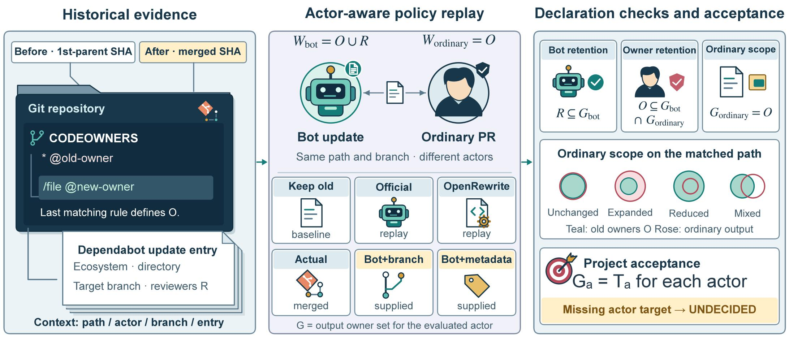

# Auditing Owner Preservation and Scope in Review Policy Migration

**Xiaoling Sun · Chengyan Li · Tianyu Chen · Juan Fang**

Beijing University of Technology

[Read the paper (PDF)](CSCWD2027-frozen.pdf) · [Supplementary information (PDF)](CSCWD2027_S1.pdf) · [Download artifact ZIP](https://raw.githubusercontent.com/sxxl0326-collab/review-policy-migration-audit/main/CSCWD2027_S1.zip) · [Reproduction guide](REPRODUCTION.md)

## What the study examines

GitHub’s migration from Dependabot-specific reviewer assignments to path-based CODEOWNERS rules can retain a bot reviewer while dropping another owner or changing who is declared responsible for ordinary pull requests. We replay Official and OpenRewrite on historical repository snapshots, compare their outputs with the policies maintainers merged, and trace changes to the winning rules. We also compare owner declarations before and after excluding the PR author and measure how candidate restorations affect other paths.



*Figure 1 from the paper. Historical declaration checks and project acceptance are evaluated separately.*

## Find the evidence

| Research question | Result reported in the paper | Where to inspect it |
| --- | --- | --- |
| **RQ1 · Which responsibilities change?** | On 24 inputs converted by both tools, both omitted owners in the same five repositories. The two additional exposed repositories had no omissions. | [Paired repository outcomes](reviewer_entry/common24_repository_breakdown.csv) · [History-to-PR evidence, Tables III–IV](reviewer_entry/case_index.csv) · [Additional migration cohorts](new_cohorts/A_repositories.csv) |
| **RQ2 · What remains after author exclusion?** | PRs with apparent owner additions decreased from **10/19 to 1/19** and from **7/25 to 2/25** in the two cohorts. | [Original 19 PRs, Fig. 5](reviewer_entry/pr_matrix_19.json) · [New 25 PRs](new_cohorts/B_pr.csv) · [Repository-level counts](new_cohorts/B_repositories.csv) |
| **RQ3 · How do replays differ from merges, and how far do edits reach?** | Both replays matched the merge in all evaluated contexts for **13/24** common inputs. In the preview analysis, **13/25** attempts changed paths outside the probes. | [Agreement by repository](reviewer_entry/common24_repository_breakdown.csv) · [25 preview attempts, Table V](reviewer_entry/preview_attempt_crosswalk.csv) · [Probe and rule details](reviewer_entry/preview_probe_rules.csv) · [Path-level changes](audit_revision/semantics_preview_20261109/preview_scope_detail/all_path_differences.jsonl) |

## Run the offline checks

From an extracted artifact ZIP or a checkout, use Python 3.10+ from the repository root. These checks use saved files and bundled matcher dependencies.

```sh
python new_cohorts/verify_new.py
python check_strata.py
```

The first command recomputes **25 PR-level set comparisons and 788 context–policy rows**. The second checks the owner/reviewer strata against frozen records. See the [reproduction guide](REPRODUCTION.md) for expected outputs, the preview join key, and the boundary between recomputing saved results and rerunning the original migration tools.

## Repository map

| Location | Contents |
| --- | --- |
| [`reviewer_entry/`](reviewer_entry/) | Paper-facing indexes for historical cases, paired outcomes, PRs and previews |
| [`new_cohorts/`](new_cohorts/) | Selection protocol, saved configurations and new-cohort verification |
| [`previous_tables/`](previous_tables/) | Original repository-level audit records |
| [`audit_revision/`](audit_revision/) | Matcher cases and whole-tree preview differences |
| [`primary_and_wave1/`](primary_and_wave1/) and [`wave2_frozen_collection/`](wave2_frozen_collection/) | Historical context records, replay source and bundled matcher runtime |
| [`figures/`](figures/) | Supporting drawings and exported figure assets. Use the manuscript for the final numbered figures. |
| [`SHA256SUMS`](SHA256SUMS) | SHA-256 checksums for the published files |

## Citation

Xiaoling Sun, Chengyan Li, Tianyu Chen, and Juan Fang. *Auditing Owner Preservation and Scope in Review Policy Migration*. Manuscript and research artifact. Cite the Git commit used for your analysis along with the manuscript.
